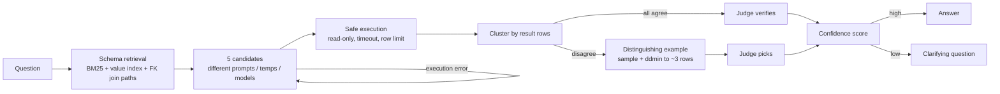

# Verified Text-to-SQL

Ask a database a question in plain English. Instead of trusting one LLM's SQL, this system **writes several candidate queries, runs them, and checks them against each other**. When they disagree, it builds a *tiny example database* that shows exactly where they differ and asks a judge to decide. When it still isn't sure, it **abstains and asks a clarifying question** instead of guessing.

```
Q: Which customers spent more than 10,000 last month?

  5 candidates → 2 result clusters (3 vs 2)
  distinguishing example: 1 customer + 1 cancelled order (found among 1,500 orders)
     query A → []            (ignores cancelled orders)
     query B → ["Zoya Iyer"] (counts the cancelled order)
  judge: A — "B counts a cancelled order as spending"
  confidence 0.91 → answer: 23 customers
```

## Results

> Fill this in from `runs/<name>/report.md` after your BIRD run. Report holdout numbers for the confidence threshold (see `eval/calibrate.py`).

| Method (BIRD dev, n=…) | Execution accuracy |
|---|---|
| First candidate only | … |
| Majority vote over result clusters | … |
| **Verified pipeline** | **…** |
| Oracle (any candidate correct) | … |

| Component removed | Δ accuracy |
|---|---|
| Judge (majority vote only) | … |
| Distinguishing example (judge sees raw outputs) | … |
| Self-repair | … |
| Value hints | … |
| Schema retrieval | … |

At threshold … the system answers …% of questions with …% accuracy (holdout).

## How it works



| Stage | What it does | Code |
|---|---|---|
| Retrieval | For large schemas: BM25 over column docs, fuzzy value index (finds which column contains "Pune"), Steiner-tree join completion over foreign keys. Small schemas go into the prompt whole. | `t2s/retrieval/` |
| Generation | N candidates in parallel via the LLM Gateway; each repairs itself on execution errors | `t2s/generate/` |
| Execution | SQLite: read-only file + authorizer callback + deadline. Postgres: SELECT-only role + read-only transaction + statement timeout. A sqlglot tree walk gives friendly errors, but is not the safety boundary. | `t2s/execute/` |
| Clustering | Group by result multiset (row order, column order and int/float differences ignored) | `t2s/verify/cluster.py` |
| Distinguishing example | Sample rows + FK parents into in-memory SQLite until the two queries differ, then shrink with delta debugging | `t2s/verify/distinguish.py` |
| Judge | Picks between the top two clusters using the example, or verifies a unanimous answer | `t2s/verify/judge.py` |
| Confidence | Logistic score over agreement, margin, judge verdict…; weights learned on a held-out split | `t2s/confidence.py`, `eval/calibrate.py` |

Why each decision was made, and what was rejected: [`docs/design.md`](docs/design.md).

## Quickstart

```bash
python -m venv .venv && source .venv/bin/activate
pip install -r requirements-dev.txt
python scripts/make_demo_db.py          # demo shop database (SQLite + Postgres dump)
cp config.example.toml config.toml      # set model names your gateway exposes
cp .env.example .env && export $(cat .env | xargs)   # GATEWAY_KEY=gw_...
pytest -q                               # offline tests, no LLM needed
uvicorn api.main:app --reload --port 8000
```

```bash
curl -s localhost:8000/api/ask -H 'content-type: application/json' \
  -d '{"database":"shop","question":"Which customers spent more than 10,000 last month?","evidence":"last month refers to October 2026"}' | jq '.answer, .confidence'
```

**Postgres demo:** `docker compose up` starts Postgres with the demo data and a read-only role, plus the API. Inside Docker, set `[gateway] url = "http://host.docker.internal:<port>"` to reach a gateway running on your machine.

## Evaluation

```bash
make eval-demo                                   # 12 demo questions
# BIRD dev: download from https://bird-bench.github.io/ into ./bird
python -m eval.run --dataset bird/dev.json --db-root bird/dev_databases --limit 300 --name dev300
python -m eval.calibrate runs/dev300 --target-accuracy 0.9
python -m eval.ablate --dataset bird/dev.json --db-root bird/dev_databases --limit 200
```

Runs are resumable and land in `runs/<name>/` (`results.jsonl`, `traces.jsonl`, `summary.json`, `report.md`, charts). Every run reports three baselines for free: first candidate, majority vote and oracle. See [`docs/evaluation.md`](docs/evaluation.md).

## Layout

```
t2s/            the pipeline (retrieval, generate, execute, verify, confidence)
api/            FastAPI server (JSON + Server-Sent Events per pipeline step)
eval/           BIRD runner, metrics, ablations, calibration, reports
finetune/       LoRA fine-tuning of a small model + serving through the gateway
scripts/        demo database generator
data/demo/      demo SQLite DB, Postgres dump, 12 BIRD-format questions
docker/         Postgres init with a read-only role
docs/           design decisions, evaluation guide, bug journal
web/            frontend (React + Vite)
tests/          offline tests with a scripted fake LLM
```

## Requirements

Python 3.11+. An OpenAI-compatible LLM endpoint (built for my LLM Gateway, which adds caching, free-tier-aware routing and fallback). Fine-tuning needs a GPU (a free Kaggle/Colab T4 is enough for a 1.5B model).
